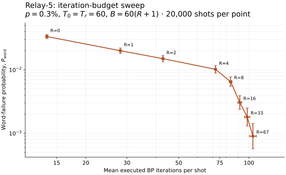

# chipsLDPC

Generate and simulate fixed-graph QEC decoders from a Stim circuit. The experiment
runner prepares circuit-level noise samples, emits SystemVerilog, builds a
Verilator simulator, and plots decoder failure probability.

## First run

Install Python 3.12+, Java 17+, Verilator, a C++ compiler, and Make. Mill is
included. See [setup](docs/source/getting-started.md) for installation commands.

```sh
./chipsldpc setup
./chipsldpc doctor
./chipsldpc run experiments/smoke.toml --out runs/smoke
```

The small repetition-code experiment exercises the complete RTL workflow at
`p = 0.003`. The runner prints the run directory and plot paths. Its small shot
count checks the workflow; use more shots for an error-rate estimate.

## Main result

```sh
./chipsldpc run experiments/bb144-p003.toml --out runs/bb144-p003
```

This runs Relay-BP on the `[[144,12,12]]` bivariate-bicycle Z-check sector at
`p = 0.003`: 20,000 shared shots and eight iteration budgets. It is a substantial
simulation. Start with the smoke experiment above.



The figure is archived data. Check it without installing the simulation toolchain:

```sh
./chipsldpc results check
```

[Reproduce and interpret the result](docs/source/reproduce-results.md) ·
[Use your Stim circuit](docs/source/custom-circuit.md) ·
[Change the decoder](docs/source/change-decoder.md)

## Documentation

[Read the documentation](https://ashish-kakkar6.github.io/chipsLDPC/) for the
workflow, model definitions, and hardware reference.
[Watch BP on the Steane code](docs/source/walkthrough.md) or read the
[QEC decoding slides](docs/source/_static/learning/qec-decoding-vtt.pdf).

The hardware implements quantized min-sum vanilla BP and Relay-BP. A Python
backend supports algorithm experiments before an RTL implementation. Changing a
Python decoder does not generate hardware for that algorithm.

`src/main/scala/chipsldpc/` contains the hardware. `benchmarks/` contains circuit
preparation, simulation, and reporting. `experiments/` contains runnable profiles.
The architecture reference also covers the independent GF(2) and OSD components.

Licensed under [Apache 2.0](LICENSE).
